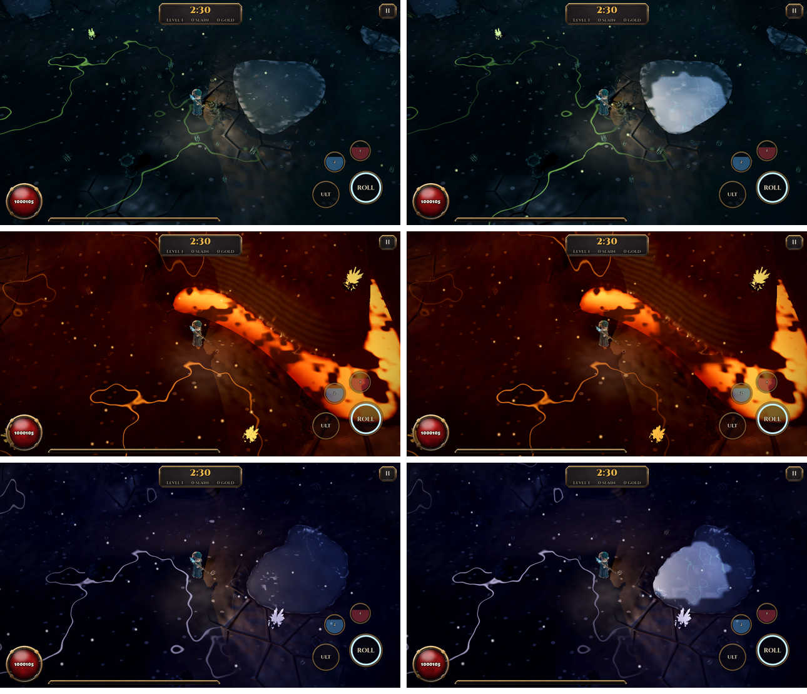

# Shardfall: Rift Survivors — Godot 4 overhaul

The original single-file HTML game (`reference/shardfall_survivors_web.html`, ~5,900 lines of
canvas + three.js) was re-built as a Godot 4.7 project in `godot/`. The core loop is the same
(auto-firing weapons, a swarm, XP gems, level-up cards, a boss at 2:30) and the four heroes, four
weapons, four stages, elemental perks and elite affixes were carried over. Around it sit 20 new or
reworked systems, then three rounds of measured critique and fixes.

## Architecture

```
scripts/sim/      pure simulation, no nodes; runs headless at any speed
  world.gd        run state, player, weapons, damage pipeline, reactions, drops, level-ups
  swarm.gd        all foes as packed struct-of-arrays (swap-remove, uid index)
  spatial_grid.gd hashed uniform grid, linked buckets, allocation-free rebuild
  stats.gd        base / added / increased / more modifier pipeline, grouped by source
  buffs.gd        timed buffs with stacking policies, feeding Stats
  items.gd        item generation, affix tiers, crafting operations, validation
  director.gd     pacing director + event deck (the "happenings")
  bosses.gd       stage tyrants, rift guardian, rogue exiles / nemesis, pinnacle Herald
  atlas.gd        seeded node-graph map
  crowd_compute.gd GPU separation (local RenderingDevice) with CPU fallback
scripts/render/   WorldView: MultiMesh swarm + glow batches, canvas-drawn telegraphs/loot/UI-in-world
scripts/ui/       HUD, touch controls, every menu/overlay, theme kit
shaders/          swarm SDF bodies, additive glow sprites, procedural ground
tests/            unit tests, bot player, stress bench, screenshot tour
```

The simulation never touches rendering, so the same `World` is driven by a touch/keyboard/gamepad
player in the game and by `tests/bot.gd` in headless balance runs. That separation is what made the
three critique cycles measurable instead of opinion.

## The 20 enhancements

| # | Area | Enhancement | Where |
|---|---|---|---|
| 1 | Graphics | **Batched SDF swarm renderer.** Every foe is one MultiMesh instance; a canvas shader draws the body from a per-kind polar profile with fake lighting, outline, eyes, crystal facets, elite/exile/ally rim glow, hit flash, status tint and contact shadow. 700 foes = 1 draw call. | `shaders/swarm.gdshader`, `world_view.gd` |
| 2 | Graphics | **Juice layer.** Trauma-based screen shake (squared, option-scaled), hit-stop on elite kills, slow-motion on perfect dodges, full-screen flash (dampened by *Reduce flashing*), low-life pulsing vignette, roll afterimages, additive particle bursts, loot beams whose height encodes rarity, edge-of-screen compass to off-screen objectives. Damage numbers are pooled, merged per foe within 0.12 s, tiered (normal / crit / reaction / reaction label / DoT) and filtered by option. | `world_view.gd`, `hud.gd`, `world.gd::_text` |
| 3 | Graphics | **Unified telegraph system.** One `Tele` type (circle, ring, line, cone) with arm-time fill, persistent ticking zones, spinning beams, following zones, friendly/hostile flags. Every boss attack, meteor, volatile death and consecrated ground uses it, so every threat is readable. Colour-blind mode adds hatching. | `world.gd::Tele`, `_draw_tele` |
| 4 | Controls | **Floating virtual joystick** with dead zone and a 1.6 power response curve, fixed-stick option, left-handed mirroring, multi-touch buttons with charge rings; keyboard and gamepad through a runtime InputMap; Android back button and focus-loss auto-pause. | `touch_controls.gd`, `main.gd` |
| 5 | Controls | **Dodge roll with input buffer and Perfect Dodge.** 0.26 s i-frames, 0.15 s buffer so an early press still rolls, and a hit absorbed in the first 0.2 s of a roll triggers 0.35 s slow-mo and *Riposte* (guaranteed crits for 2 s). | `world.gd::_roll`, `hurt_player` |
| 6 | Controls / Options | **Targeting modes** (nearest / strongest / facing cone), a manual **hero Ultimate** charged by damage, two **flasks** charged by kills, and a full **Options** screen: sound, volume, shake, damage numbers, aim mode, joystick mode, left-handed, colour-blind palette, reduce flashing, haptics, auto-equip, loot filter, effects quality, FPS, touch-button override. | `world.gd::use_ult/use_flask/_target`, `screens.gd::show_options` |
| 7 | Powersets | **Cross-element reaction cascades** (PoE2-style). Seven reactions (Thermal Shock, Toxic Combustion, Superconduct, Overload, Hemorrhagic Arc, Septic Wound, Frostbite). Applying an element to a foe carrying a partner status queues a reaction; reactions re-apply an element to what they hit, which can trigger more. Bounded by depth cap (2), 0.7x falloff per step, a 0.45 s per-foe cooldown and a 24-per-frame budget. | `content.gd::REACTIONS`, `world.gd::apply_elements/_react` |
| 8 | Powersets | **Support-gem links.** 11 gems (Chain, Multiple Projectiles, Concentrated Effect, Increased Area, Faster Casting, Spell Echo, four Infusions, Brutality), two sockets per weapon, tag-gated (projectile / area / spell). Gems are weapon-local `Stats` layered over the global pipeline. | `content.gd::GEMS`, `stats.gd`, `world.gd::wlocal` |
| 9 | Powersets | **Keystones** offered at levels 8, 16 and 26: rule changers such as Elemental Equilibrium, Glass Cannon, Chain Reaction, Blood Magic, Iron Reflexes, Pain Attunement, Vaal Pact, Unstoppable Momentum and Avatar of Catalysis. | `content.gd::KEYSTONES`, `world.gd::make_choices` |
| 10 | Lootables | **Rarity-tiered items** in four slots, 15 affixes with item-level-gated tiers, prefix/suffix limits per rarity, implicit mods, a power score for upgrade arrows and auto-equip, loot beams, loot filter (filtered drops auto-sell). | `items.gd`, `content.gd::AFFIXES` |
| 11 | Lootables | **Component crafting**: eight shards (Change, Growth, Crown, Chaos, Star, Null, Divine, Rift Ember corruption). Every operation validates preconditions, never consumes currency on failure, and keeps items valid (property-tested over 600 items x 8 operations). | `items.gd::craft`, `screens.gd::show_stash` |
| 12 | Lootables | **Legendary powers + Cube.** Eight unique powers (The Furnace, Stormherald Coil, Rimeheart, Gorefeast, Cascade Sigil, Gremlin's Greed, Phoenix Ember, Ouroboros Treads). Dissolving a legendary in the Cube stores its power in the Codex; three are active per run regardless of gear (D3 Kanai's Cube). | `content.gd::LEGENDARIES`, `main.gd` "extract" |
| 13 | Collectibles | **Bestiary and Lore.** Kill counts per foe type unlock tiers (10 / 100 / 1000) worth +3% damage each and a lore line; 12 lore pages drop from events, shrines and bosses; each set of four grants +5% damage and +10 life permanently. | `save.gd`, `world.gd::drop_lore`, Codex screen |
| 14 | Powerups | **Pylons and shrines** (D3): Power, Conduit, Channeling, Shield and Speed pylons; Fortune, Enlightened, Frenzied and Empowered shrines, placed by the Director. | `director.gd::_place_object`, `content.gd::BUFFS` |
| 15 | Powerups | **Buff framework with stacking policies** (refresh, intensity, duration-extend, unique) and pylon diminishing returns; also drives flasks, Soul Harvest stacks, Aegis, Overclock, Vital Surge and ultimates. | `buffs.gd` |
| 16 | Optional boss | **Pinnacle: the Shard Herald.** Summoned with three fragments (Rupture from Breach splinters, Greed from gremlins, Dread from cursed chests, or any from Citadels). Arena lock, three phases at 66% / 33% with invulnerable transitions and adds, weighted no-repeat attack selection biased by range (volley, slam chain, summon, twin spinning beams, closing arena ring, shard storm), enrage at 3:00. | `bosses.gd::_herald` |
| 17 | Optional boss | **Rogue Exiles and Nemesis.** A named rival with one of your weapons' patterns and a blink-away reaction to burst damage. If an exile kills you it is saved as your Nemesis and returns next run one level stronger, guarding a guaranteed legendary. | `bosses.gd::spawn_exile/on_player_death` |
| 18 | Events | **Pacing Director + happenings deck.** Build / Peak / Relax phases driven by smoothed intensity (damage taken + swarm density); weighted deck with cooldowns, earliest times, no repeats, concurrency cap and prerequisites. Ten events: Breach, Treasure Gremlin, Cursed Chest, Strongbox, Eclipse, Starfall, Wandering Merchant (gamble), Delirium Mirror, Blood Ritual, Rogue Exile. | `director.gd` |
| 19 | Endgame | **Greater Rifts + seasonal affixes.** Keyed levels with +17% monster life per level (D3), a 5:00 timer, a progress bar fed by kills and progress orbs, a Rift Guardian at 100%, key upgrades (+1/+2/+3) by time left. A weekly rotating season affix (Souls, Echoes, Avarice, Blight, Mirrors) changes every mode. | `bosses.gd`, `world.gd`, `content.gd::SEASONS` |
| 20 | Endgame | **Atlas of Falls** (PoE2 node map): a seeded 7x5 graph with pruned-but-connected edges, map tiers by distance, rolled map modifiers that add item quantity/rarity, Corrupted nodes, four Citadels that drop pinnacle fragments; completing a node reveals its neighbours. | `atlas.gd`, `screens.gd::AtlasView` |

## Critique cycles

See the three sections below: each lists what was measured, what was wrong (engineering, player
friction, balance), and the change made for the next cycle. Measurements come from
`tests/run_tests.gd` (9 bot-played runs across all modes, plus a 680-foe stress bench) and
`tests/shots.gd` (screenshots on the real Forward Mobile renderer).


### Baseline (cycle 0) — first full implementation

9 bot runs + bench, before any fixes. Two runs never finished and the first sim hung outright.

| Run | Result | Level | Note |
|---|---|---|---|
| Campaign, Stormwright | timed out | **2** | 339 kills, 0 gold, 0 items |
| Campaign stage 3, Sparkcaller | timed out | **1** | 19 kills |
| Atlas citadel (tier 6), Emberwitch | **died at 2:02** | 1 | 2 kills |
| Rift GR1 vs GR8, Stormwright | won in 228 s vs **185 s** | 54 / 50 | higher GR finished faster |
| Stress bench, 680 foes, CPU | 5.23 ms / frame | | separation alone 4.24 ms (81%) |

Screenshots (`docs/screenshots/cycle0_*`) showed an empty battlefield and broken overlays.

### Critique cycle 1

**Engineering**
1. *Hang:* `SpatialGrid` bucket heads started at 0, so any query before the first rebuild (the bot
   thinks before the first step) walked a self-loop on foe 0 forever. → heads/next start at -1;
   regression test `unbuilt grid reads empty`.
2. *Invisible swarm:* the MultiMesh bounding box is computed once from the initial all-zero
   transforms and never again (buffers are uploaded wholesale), so the whole batch was culled once
   the camera left the origin. → huge `custom_aabb` on both batches.
3. *Zero-size UI root:* anchors were set before the root Control entered the CanvasLayer, so its
   size stayed 0: no dim behind overlays, uncentred sheets, HUD bars 270 px wide. → anchors and
   offsets applied after `add_child`, everywhere.
4. *Stale frame:* the last world frame stayed on screen under every menu. → view hides without a run.
5. *Cape triangulation error* when facing straight up/down (self-intersecting quad). → two triangles.
6. *Perf:* CPU separation was 81% of the sim frame. → staggered 30 Hz solve (half the swarm per
   frame) and a tighter query radius. The GPU path was verified on Vulkan (lavapipe): 0.90 ms for the
   whole foe step.
7. *Leaks:* World ↔ Director/Bosses reference cycles leaked every run. → `World.dispose()`.

**Player friction**
8. *Loot stranding:* ranged kits (Skyfall strikes anywhere on screen) killed far away and the XP,
   coins and currency stayed there; the kiting bot (like a kiting player) never collected them.
   → shard gravity: drops older than 3 s drift home, accelerating with age.
9. *DoT noise:* streams of "1" ticks. → ticks under 3 damage and under 2% of the foe's life are not shown.

**Balance**
10. *Atlas wall:* tier and biome multipliers stacked (2.5x tier × 3.0x biome) on a level-1 hero.
    → atlas difficulty comes from tier only; the start node has no mods.
11. *Runaway power:* linear XP plus 4–10%-per-level scalars let bots reach level 50+ and made GR8
    faster than GR1. → XP need gains a 0.15·l² term; per-level scalars cut to 3/5/6%.

**Result:** Stormwright level 2 → **25**, stage-3 Sparkcaller level 1 → **27**, atlas citadel
death → **win**, GR8 now slower than GR1. Bench 5.23 → **3.33 ms** (separation 4.24 → 2.24 ms).

### Critique cycle 2

**Engineering**
1. *Second hang* (found by the cycle-1 re-run): when a boss dies, `_victory` deals 1e9 to leftover
   foes; a fleeing Treasure Gremlin then reported a life fraction of about −10⁷ and the
   "spill coins per 10% lost" loop ran millions of iterations. → fractions clamped to [0, 1],
   dying gremlins skipped; same clamp on the exile blink check; regression test.
2. *18.8 ms frame spike:* reproduced only in the first run of a process; an isolated replay of the
   same seed never exceeded 5 ms. It was first-use cost of script paths, not gameplay. → bench warm-up
   run; worst frame afterwards **6.7 ms**.

**Player friction / readability**
3. Foes blended into busy ground (orange on brown). → contact shadow under every body and a thicker outline in the swarm shader.
4. On-screen touch buttons covered the play area on desktop/gamepad. → shown only after a real touch (or by option).

**Balance** (from cycle-1 data: 8 of 9 bot runs won, mostly above 60% life)
5. Atlas tier step 0.22 → 0.35; enemy damage now ramps +1/3 over five minutes; rift monster life ×1.5 and slower progress.
6. The Herald died in 33 s. → life 24000·(0.5 + 0.05·level), and a denser 90 s preparation phase.

**Result:** campaign 4/5 wins with one death to boss bullets; Herald fight about **110 s**.
New problems: the atlas citadel became a wall again for a fresh hero, and rift difficulty barely
rose between GR1 and GR8.

### Critique cycle 3

**Engineering / balance (one bug, found from data)**
1. *Self-refunding ultimate:* an Emberwitch cleared **GR25** (≈65x monster life) averaging 31,716
   DPS. Tagging damage by source showed 240k of 264k damage came from the ultimate: Cataclysm hits
   every foe on screen, and ultimate charge came from damage dealt and kills, so one cast refilled the
   bar and it recast forever. → charge is locked for 6 s after a cast and capped at 8 per second
   (a full bar needs at least 12.5 s of fighting); regression test `ultimate does not refund itself`.

**Player friction**
2. *Unmeetable bosses:* GR1 reached 100% and still timed out: the guardian spawned off-screen and
   walked at 50 px/s toward a hero kiting at 155 px/s. → bosses arrive on-screen (55% of the view
   radius) behind a summoning ring; the bot seeks out live bosses as a player would via the compass.
3. *Atlas head start:* maps grant two extra level-up picks per tier above 1 and ramp the tier
   multiplier in over the first minute, so a fresh hero can draft a build before full pressure.

**Performance**
4. Foes more than a screen away no longer run separation at all. CPU separation 2.24 → **1.94–2.23 ms**
   (run-to-run noise), sim frame **2.8–3.3 ms** at 680 foes.

**Final measured state** (`tests/run_tests.gd -- sim bench`):

| Run | Result | Time | Level | Low life |
|---|---|---|---|---|
| Campaign stage 1 (4 heroes) | 2 wins, 1 death, 1 time-out | 142–200 s | 12–28 | 0–54% |
| Campaign stage 3, Sparkcaller | win | 187 s | 21 | 54% |
| Atlas citadel tier 6, Emberwitch | win | 176 s | 34 | 60% |
| Greater Rift 1 / 8 / 15 | win / win / win | 207 / 203 / 269 s of 300 | 31–32 | 64–85% |
| Greater Rift 25 | wall (1 kill) | time-out | 1 | 58% |
| Pinnacle: Shard Herald | win | 170 s | 17 | 40% |
| Stress bench 680 foes | CPU 3.29 ms total | | | |

### What would still make it better (next iteration)

* **Warden underperforms** in every bot run (lowest DPS, the one stage-1 death). Part of that is the
  bot's melee play, but the orbit weapon's reach vs. contact damage needs a human playtest pass
  before numbers change.
* **Reaction mix is lopsided**: Thermal Shock is 60–90% of all reactions because fire and cold are
  the most common perk pair. Either rebalance perk weights or give each reaction a distinct niche
  (e.g. Superconduct as the boss-killer).
* **Late-rift spikes**: GR15 peaked at 14 ms worst frame with 1,500+ reactions and 44 damage numbers
  per second. Next steps: spread the reaction budget across frames instead of dropping jobs, and move
  `Swarm` (statuses, separation, movement) to a C++ GDExtension for the CPU path.
* **APK size**: 55 MB because the debug build ships x86_64 for emulators too; arm64-only release is
  roughly half.
* **No art pipeline**: everything is procedural (SDF bodies, canvas-drawn props). A sprite atlas would
  plug into the same MultiMesh batches via a texture and UV rect in `INSTANCE_CUSTOM`.
* **Bot ≠ human**: all balance numbers come from a deliberately mediocre bot. Touch feel (dead
  zone, curve, button sizes) has only been verified in screenshots, not on a phone.


## Terrain: elevation, water and elemental ground (scripts/sim/terrain.gd)



Fights stay on the flat simulation plane; the ground is a seeded heightfield the sim and every shader share.

* **Shape:** 640-unit chunks of 40 x 40 cells (16 units), generated on demand and prefetched one per
  frame. Per act (`Content.TERRAIN`): rolling hills with lakes and streams (Mossglen), terraces cut
  by lava rivers (Cinder), sunken pits, ledges and black pools (Crypt), plateaus over void chasms (Neon).
  A 260-unit plateau around the start (and the Herald's whole arena) is always flat and dry.
* **Rules:** cliffs (rise per cell above the act's limit) and deep liquid block movement; the hero
  and foes slide along them and blocked foes sidestep around. Shallows slow to 65%; lava shallows
  burn (5% life every half second). Spawns, events and breakables land on walkable ground.
  Striking down from 24+ units of high ground deals +15%.
* **Elements and the ground:** cold on a foe in water freezes a 60-unit ice sheet for 6 s that anyone
  can cross (over lava it is an obsidian crust); lightning on a foe in water electrifies the pool and
  arcs to every foe wading in it (80% weapon damage, up to 10); fire on water raises steam and melts
  ice. The Sparkcaller's Absolute Zero freezes every lake on screen for 9 s. The void never freezes.
* **Rendering:** the 7 x 7 chunks around the hero become one R32F height texture and an RG8 state
  texture (ice, charge), published as global shader uniforms. The ground is a camera-following grid
  displaced in the vertex shader; foes, sparks, projectiles, loot, decals, telegraphs and bolts add the
  same bilinear height, so everything stands on the same hill without per-object bookkeeping. Water,
  lava and void are one surface shader at the act's liquid level, shading by depth from the height
  texture. Fog stays flat, so it pools in valleys. The classic 2D view draws a top-down terrain map.
* **Cost:** chunk generation 2-4 ms; terrain adds ~0.9 ms to foe movement at 680 foes (cell fast path).

Critique passes: (1) [hills invisible from the high camera, water lost against dark grass, ice a
blocky white sticker](screenshots/terrain_pass1.png): valleys now darker and ridges lighter, water has
a sky sheen, glints and foam, ice has soft edges, cracks and frost; (2) lava swamped foes in combat
([before](screenshots/terrain_combat.png)): now dark crust plates with glowing seams
([after](screenshots/terrain_lava_pass2.png)). [Electrified water](screenshots/terrain_electrified.png),
[2D view](screenshots/terrain_2d.png).
