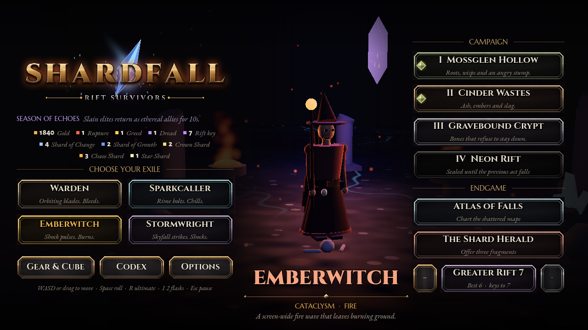

# Graphics, audio and feel upgrade (PoE2 direction)

The first Godot build drew a flat 2D world. The HTML version you started from had a Three.js 3D
scene (tilted camera, articulated characters, instanced swarm, sun, torch, fog), so the Godot
build now has a full 3D renderer. The simulation is untouched (sim `(x, y)` becomes 3D
`(x, height, y)`), so balance, tests and the bot runs are unaffected. The classic 2D renderer is
still there under **Options > Renderer** as a fallback.

## What is on screen

| Layer | Implementation | Draw calls |
|---|---|---|
| Camera | 40° FOV perspective at a 52° pitch, leads the hero in the movement direction, pulls back 18% during boss fights, trauma shake with a little roll, portrait phones get a higher camera | - |
| Post | ACES tonemap, soft-light bloom on everything emissive, exponential fog in the stage colour, contrast/saturation grade, screen vignette; SSAO when running Forward+ | - |
| Lights | low sun with 2-split shadows; flickering torch on the hero (the PoE "light pool"); a key light on the camera side of the hero; **8 pooled omni lights** reassigned every frame to the brightest effects (novas, reactions, lightning, slams, meteors, elite deaths, rare loot, shrines, events), weighted by distance to the hero | - |
| Ground | `shaders/3d/terrain.gdshader`: world-space fbm palette per stage, rare flagstone patches with cracks, dirt hollows, pebbles, normals derived from the height field so light rakes across it, faint pulsing shard veins; optional authored texture slot | 1 |
| Props | 6 instanced kinds scattered per 640-unit chunk (trees, rocks, glowing crystals, ruined pillars, bones, grass that sways), density per stage, dithered see-through when between camera and hero | 1 per kind |
| Hero | `HeroRig`: 4 articulated heroes (pivots for hips, torso, head, arms, weapon, cape) with procedural run, cast (turns to and thrusts at the target), roll (tuck and flip), red hit tint, breathing, death | ~40 meshes |
| Foes | one baked mesh per kind, **one MultiMesh per kind**; the vertex shader swings legs and arms, bobs heads, waves tendrils, leans into the chase and squashes on hits; eyes and crystals glow; statuses glow at the rim; elites and exiles get gold/orange rims | 1 per kind |
| Bosses | `BossRig`: horned tyrant with wings, ribcage furnace and a slam wind-up; the Herald as a translucent crystal with a glowing core, orbiting shards and halo | ~30 meshes |
| Effects | projectiles with 3-ghost trails; gem crystals; death debris that tumbles, bounces and settles; sparks with gravity; spinning blades; 3D pickups (coins, orbs, items, fragments); rarity loot beams; lightning as camera-facing ribbons from the sky; one decal shader for telegraphs (circle, ring, line, cone), shockwaves, rune circles; blood, scorch and crater marks that fade over 20 s; event props (chests, pylons, shrines, merchant, altar) | ~12 + up to 110 decals |
| Overlay | damage numbers that pop and rise, PoE-style loot plates (dark plate, rarity border), elite affix tags, exile nameplate and bar, event timers | 2D |

## Asset slots ("space for the models")

Every visual and sound has a drop-in slot; empty slots use the procedural version.

* `godot/models/heroes|bosses|foes|props/` (see `godot/models/README.md` for names, scale, axes,
  and the UV2 convention that lets an authored foe mesh keep the shader's limb animation)
* `godot/audio/sfx/<name>` and `godot/audio/music/<stage>` (`godot/audio/README.md`)
* `godot/textures/terrain/<stage>.png`

## Feel (PoE2 references)

* **Turning to cast:** the hero snaps toward each spell's target for 0.35 s, then back to the movement direction.
* **Weight on crits:** a 25 ms freeze plus a crack sound and a small shake, limited to at most ~4% of play time.
* **Hits read without strobing:** foes pop with a short, curved flash and a squash-recoil. The hero gets a red tint, not white.
* **Deaths:** bodies burst into tumbling shards that bounce and settle, and leave a mark that fades.
* **Loot:** beams grow taller with rarity, and plates show the name in rarity colour. Drop chimes get brighter with rarity, and the legendary one rings like a bell with a banner.
* **Sound:** layered synthesis instead of single beeps: a low thump under each impact, a noise crack over a rumble for thunder, filtered noise for fire, glassy highs for ice. Each stage has a wind-and-drone ambience loop. Sounds fade with distance from the hero.

## How it was tuned (visual critique passes)

All passes were checked with the screenshot tour on the real Forward Mobile renderer (Vulkan via
lavapipe) and the model turntable (`tests/model_view.tscn`).

| Pass | Problem seen | Fix |
|---|---|---|
| G1 | Too bright and busy: the flagstone pattern covered every surface (the patch mask was inverted), veins glowed like neon, orange foes on orange ground, the hero ~40 px tall | Flagstones only in rare patches, dirt hollows, desaturated and darker ground, thin dim veins, darker foe bodies with glowing accents, camera 760 → 600 |
| G2 | Herald and anything in melee range flashed **pure white**, because they are hit continuously and the flash was strong and linear | Short, curved, tinted flash, much weaker on bosses |
| G3 | Turntable showed the heroes as blocky crates (huge box torso, tiny head, weapons hanging down) | Rebuilt with heroic proportions: tapered chest, rounded limbs, bigger head, upright staves, robes, hood, pauldrons |
| G4 | Metal rendered black (no sky to reflect); the Herald's core was hidden inside an opaque shell | Low metallic, translucent crystal shell |
| G5 | **No torch pool at all**, on both Mobile and Forward+ | Godot's omni falloff is `distance^-attenuation` in world units. At this scale (hero ~60 units, torch 52 units up) the usual 1.0–1.6 falloff multiplied every light by ~0.002. Fixed with a 0.5 falloff and an energy gain; the torch pool, spell lights and boss furnace lights all appear. |

## Performance notes

* CPU cost of the 3D view (all buffer uploads, rigs, effects, light assignment) measured
  0.8–1.0 ms per frame in the screenshot tour. GPU cost could not be measured here (software
  Vulkan runs at ~5 fps); it needs a real device.
* Foe buffers are written into one flat member array and sliced per kind at upload. In GDScript,
  writing into an element of an Array of PackedFloat32Arrays copies the whole array on every
  write, which would have cost ~40 MB of copying per frame.
* Low effects quality turns off sun shadows and foe shadow casting, uses 3 terrain noise octaves
  instead of 5, and lowers the caps on sparks and debris.


## PoE2 pass 2: characters, enemies and a reactive world

### Characters and enemies

* **Material shader** (`shaders/3d/char.gdshader`) for heroes, bosses and exiles. Detail is computed
  in part-local space so it stays on the part while it animates: cloth gets a weave and grime,
  leather gets mottled grain and scuffs, metal gets worn bright edges and pits, and skin gets a warm
  tint. Runes and crystals glow and flare on every cast. A dim reflection sky stops metal from
  rendering black.
* **Heroes rebuilt** with layered gear. The Warden has a gambeson under a breastplate, layered
  pauldron lames, tassets, greaves, a sallet with a plume, a rune-etched bastard sword and an oak
  heater shield painted with heraldry. Sparkcaller has a cowl, fur mantle, ice talismans and a
  pronged staff. The Emberwitch has a corset, a bent witch hat, hair, a skull talisman, an
  ember-lit hem and a gnarled staff. Stormwright has a mantle, sash, glowing arm tattoos and a
  forked rod. Knees and elbows bend.
* **Muted dyes:** each hero's colour is now a desaturated dye on the cloth, and full saturation is
  saved for runes and heraldry (PoE2 palettes).
* **Cape and robes in motion:** the cape is four chained segments on a damped spring driven by
  speed, with flutter that grows when running. Robes are front and back panels that kick and trail
  with the stride.
* **Grim foes:** a ghoul with ribs, claws and crystal growths; a feral hound; a rubble golem with
  a glowing core; a pustule-covered bloat; a crystal-swallowed husk; a crystal mite; a tusked boar;
  an abyssal tentacle mass; a sack-hauling imp.
* **Foe skin:** the foe shader adds dark, desaturated, mottled skin with veins and crevice
  darkening, plus a per-foe seed so no two look alike.
* **Corpses** fall backwards away from the hero, lie for a moment, then crumble from the edges
  with an ember burn line (PoE2 keeps corpses on the ground; here they are a timed visual so the
  simulation is unchanged).
* **Monster rarity:** magic monsters (one affix) get a blue rune ring on the ground, rare monsters
  (two or more affixes) a gold one.
* **Rogue Exiles** are drawn with the full hero rig in dark gear and turn and cast like a player.
* **The tyrant boss** is a charred demon: ashen hide with ember cracks, digitigrade legs, curved
  segmented horns, membrane wings with a glowing trailing edge, bone ribs over a pulsing furnace.

### Environment reacting to the hero and the swarm (`scripts/render3d/env_fx.gd`)

| Effect | How |
|---|---|
| Grass bends and flattens around bodies, and shockwaves roll over it | `pushers[16]` uniform (hero, a rotating sample of nearby foes, expanding nova and reaction rings) bends every swaying vertex in the prop shader |
| Low ground fog that parts | lit translucent plane with drifting noise; the same pushers clear holes, and the torch and spell lights glow inside it |
| Footsteps | dust puffs on each footfall (plus a soft step sound), a dust ring on roll, a dust cloud when a slam lands |
| Statuses in the world | burning foes trail flame sparks and smoke, chilled ones shed frost mist, poisoned ones leak green fumes, shocked ones crackle |
| Hits | fresh hits spray ichor sparks and sometimes leave a splatter mark that fades |
| Casting | every cast flashes a short light in the element's colour at the hero's hand, with sparks |
| Ambient motes | per stage: fireflies (Mossglen), rising embers (Cinder), dust (Crypt), data sparks (Neon) |
| Breakables | urns and barrels appear in clusters near the hero; any skill area, projectile or blade shatters them into shards and dust for coins, sometimes a heart, power-up or currency (simulation side in `World.shatter`, unit-tested) |
| Light | warm torch against a cool ambient (PoE2's warm/cool split); on high quality the torch casts shadows that radiate from the hero |

### Critique loops for this pass

| Loop | Seen | Fixed |
|---|---|---|
| 1 | Toy-bright, saturated hero cloth; robes like stacked lampshades; a black mask box on Sparkcaller; foes pink and plastic; the ghoul read as a pig; huge eyes; corpse dissolve glowing white with pixel noise | Muted dyes; one flared robe split into swinging panels; an open cowl; dark desaturated foe skin with stronger rim; an upright ghoul; small eyes; a broader, dimmer burn line |
| 2 | Golem faces speckled (z-fighting between overlapping boxes and the core gem); tyrant a saturated orange toy robot | Separated surfaces; tyrant rebuilt as a charred demon on the character shader |
| 3 | Tyrant wing struts like white sticks, ribs like stitches, then ribs as hoops around its belly; Warden's shield a bright yellow slab, pauldrons like round ears | Dark horn struts, bigger membranes with an ember edge, V-shaped rib bars; oak shield with steel bands and painted heraldry; flat layered lames |
| Env 1 | Hit pops still blew out to white on the darker foes; urns looked like pink balls; cool fog washed the forest ground blue-grey | Tinted, weaker hit pop; darker urns with a foot and straps; lighter, per-stage fog density |

## UI pass: fonts, logo, tiles (PoE2 / Diablo IV direction)



### Art kit (`tools/make_art.py`, Pillow + numpy, fully procedural)

| Asset | What it is |
|---|---|
| `godot/ui/logo.png` | "SHARDFALL" in Cinzel Black, forged-bronze fill with bevel, hairline fractures, ember underglow, a tilted rift crystal driven through "RD", and a ruled "RIFT SURVIVORS" subtitle |
| `panel.png` | weathered slate, double bronze rim, corner filigree and a top crest (9-slice, margin 64) |
| `btn_{normal,hover,pressed,disabled}.png` | notched bronze plates; hover adds an ember glow |
| `tile.png`, `card.png` | neutral silver frames, tinted in Godot per hero, act, item rarity or reward type |
| `orb_frame.png`, `slot.png`, `bar.png`, `divider.png` | globe bezel, action/buff slots, bar trough, ornamental rule |
| `godot/icon.png` (from `tools/emblem.png`) | ringed falling-shard emblem for the app icon |
| `tools/web_logo.png` | 760 px logo for the web loading screen |

Fonts are OFL (licences in `godot/fonts/`), loaded as WOFF2 through `UIKit.font(role)`:

| Role | Font | Used for |
|---|---|---|
| display / display_heavy | Cinzel 700 / 900 | titles, buttons, names, reaction callouts, anything with digits in a heading |
| body / italic | EB Garamond 500 / 400 italic | descriptions, lore, flavour lines, loot plates |
| label | Marcellus SC | section rules ("CHOOSE YOUR EXILE"); never for numbers, its small-cap digits read as letters |
| num / num_heavy | Alegreya Sans 800 / 900 | life, timers, stats, damage numbers |

### Screens

* **Title / character select** (`Screens.show_menu`, `MenuStage3D`): the chosen hero idles on flagstones
  between braziers with a floating rift shard, embers and fog, on its own camera and environment far
  from the play field. The camera yaws so the hero lands between the two columns. Left: logo, season,
  resources, the four exiles as tinted tiles. Right: the campaign acts (a green gem marks a cleared act,
  sealed acts are greyed), Atlas, Herald and Greater Rift with level steppers. Portrait phones get one
  scrolling column.
* **HUD** (`hud.gd`): a liquid life globe and an ultimate globe in bronze bezels, a four-slot action bar
  with key hints and cooldown sweeps (desktop), a buff tray, a slate time plate, and a Cinzel boss bar.
  On touch screens the action bar is replaced by bronze touch rings with flask liquid levels and a
  pulsing ready ring on the ultimate.
* **Level-up** (`show_levelup`): three framed cards tinted by reward type, each with a faceted gem
  (diamond = weapon, star = evolution, round = perk, hexagon = support gem), a tag, a Cinzel name and a
  Garamond description. Keys 1 to 3 pick a card.
* **Gear** (`show_stash`): equipped and stash lists as rarity-tinted tiles, the selected item as a framed
  card with its affixes, then crafting shards.
* **Atlas, Codex, Options, Pause, Results**: bronze-ringed atlas nodes (diamond citadels, jagged
  corrupted rings), a quiet inset for Codex tabs instead of a frame inside a frame, option rows (name on
  the left, value on the right), and a results screen of stat plaques.
* **World overlay** (`overlay_3d.gd`): damage in Alegreya Sans Black, reactions in Cinzel capitals, loot
  plates in Garamond with a rarity border and an inner rule.

### UI critique loops

| Loop | Found | Fixed |
|---|---|---|
| 1 | Hero framed off-screen; Endgame below the fold at 720p; act subtitles spilling out of tiles; buff slots drawn as white squares; Marcellus SC digits reading "IOs"; gear list looked like a debug dump; atlas still used the engine font | Camera yaws to put the hero between the columns; two-column layout; textures preloaded in `_ready` (a texture first loaded inside `_draw` rendered blank); digits moved to Cinzel; gear rebuilt as tiles + item card; atlas restyled |
| 2 | Hero too close (head cropped, feet under the name plate); CLEARED tag colliding with titles; no desktop HUD in the tour; results screen was a plain list | Camera pulled back; green cleared-gem; `UIKit.touch_mode` override for tests; results rebuilt as plaques |
| 3 | Pause printed a raw gem array; nested frames in the Codex; Options a wall of identical buttons; level-up cards top-heavy; locked tiles still bright | Build summary formatted; tab inset style; option rows; shorter cards; `_lock()` fades sealed titles |

Before and after: [loop 1 menu](screenshots/ui_pass1_menu_hero_offscreen.png),
[loop 1 white buff slot](screenshots/ui_pass1_white_buff_slot.png), [level-up](screenshots/ui_levelup.png),
[desktop HUD](screenshots/ui_hud_desktop.png), [gear](screenshots/ui_gear.png), [results](screenshots/ui_end.png),
[portrait phone](screenshots/ui_portrait.png).

The UI tour runs at any size and can force either layout:

```bash
xvfb-run -a godot --path godot --rendering-method mobile --resolution 1280x720 res://tests/ui_shots.tscn -- /tmp/ui L_ 0
xvfb-run -a godot --path godot --rendering-method mobile --resolution 720x1280 res://tests/ui_shots.tscn -- /tmp/ui P_ 1
```

The web page is 15.6 MB. The logo ships at 1400 px and unused font weights were dropped to stay under 16 MB.

## Optimisation pass (render benchmark)

`tests/render_bench.tscn` plays a real run with the full 3D view at 150, 300 and 500 foes and reports
frame time, the 3D view's CPU cost, draw calls and triangles (env vars `BENCH_SIZES`, `BENCH_NO_SHADOW`,
`BENCH_NO_PROPS`, `BENCH_NO_LOD`, `BENCH_LOD`, `BENCH_ORTHO` isolate costs). Measured here on lavapipe, a
CPU rasteriser, so only the ratios carry over to real GPUs:

| Foes | Frame before → after | Triangles before → after |
|---|---|---|
| 157 | 699 → 430 ms | 1.33M → 0.92M |
| 300 | 909 → 540 ms | 1.89M → 0.96M |
| 500 | 1215 → 660 ms | 2.68M → 0.91M |

What changed:
* **Props batched per 640-unit chunk** instead of one batch per kind for the whole neighbourhood,
  so off-screen chunks are culled and distant ones draw the imported meshes' automatic LODs. Props
  had been ~70% of all triangles.
* **Leaner meshes where the camera can't tell**: swarm foes 450–1,100 triangles (grunt was 2,300),
  props 700–3,000 (tree 5,000), heroes 31–35k (42k, checked side by side on the title stage). No
  tangents on meshes without normal maps.
* LOD switches at 1.5 px instead of 1; sun shadows reach 1,150 units instead of 1,800.
* **3D resolution option** (Auto, 100%, 75%, 50%): Auto renders 3D at 75% on phones and the web
  (FSR 1 upscaling where the renderer supports it) with the UI at full resolution.
* **Show FPS** now reads frame time, draw calls, triangles, foe count and 3D resolution.
* **Web build**: hero textures at 1024 (desktop and Android keep 2048). Page 35 → 30 MB; the rest is
  the 13 MB engine and the four hero meshes, which all ship because the pack is downloaded whole.

## Graphics tiers (scripts/render3d/quality.gd)

Android and desktop are now the main target. The web artifact is a lighter preview. Tiers change
only visuals: the simulation, spawns and balance are the same on every tier.

| | Low | Medium (web default) | High (Android / desktop default) |
|---|---|---|---|
| Sun shadows | off | 2 splits, 2048 atlas, hard | 2 splits, 4096 atlas, soft |
| MSAA | off | off | 2x (cheap on tile-based phone GPUs) |
| Terrain grid | 24 units | 20 units | 12 units (~2.8x the vertices) |
| Terrain noise octaves | 3 | 5 | 6 |
| Prop density | 0.7x | 1x | 1.3x |
| Dynamic lights | 4 | 8 | 14 |
| Prop meshes | models/props | same | models/props_hi (2.5x the triangles) |
| LOD threshold | 1.5 px | 1.5 px | 1 px |
| Auto 3D resolution | 75% on phones/web | 75% on phones/web | 85% on phones (FSR), 100% desktop |
| Particles | 1/3 | full | full |

Options > Graphics: Auto (High, except Medium on the web), Low, Medium, High. The web export
excludes `models/*_hi` (export_presets.cfg), so only the APK carries them.

The high-detail variants are rebuilt by passing `--hi` to the import scripts:

    blender -b --factory-startup --python tools/blender/import_props.py -- <gen dir> --hi
    blender -b --factory-startup --python tools/blender/import_packs.py -- <packs dir> --hi   (not shipped: see below)

Benchmark triangles per frame (400 foes, including shadow passes): Medium 1.4M, High 3.5M. High
detail foes (`foes_hi`, 2x the triangles) added another 1.4M. Foes are about 30 px tall at this camera
distance, so they are not shipped; Models still loads `models/foes_hi` if it exists.

**Benchmark.** Options > Run benchmark runs a fixed, invulnerable 23 s rift: 3 s warm-up, then 20 s
measured. It holds about 400 foes, evolves every effect weapon, and walks a circle so terrain and
props stream in. The result screen shows average FPS, the 1% low, frame time, draw calls,
triangles, device, GPU and renderer. The last result is saved in the profile under `bench`.
`tests/bench_run.tscn` runs it headless for screenshots.

## Diagnosing a device (no debugger, no logcat)

The first S22 (Adreno 730) build crashed a few seconds into every run, with no engine error and flat
memory, which points at the GPU driver. Tools added to find the cause:

- **Diag** (`scripts/autoload/diag.gd`) writes a flushed trail to `user://diag.txt`: device, GPU, run
  start, then a heartbeat twice a second (foes, projectiles, effects, memory, video memory, FPS, and
  the CPU split: `sim` = World.step, `view` = WorldView3D, `cpu` = whole process frame). If frame
  time is far above sim + view + UI, the GPU is the bottleneck. A session without a clean-close line
  is shown on the next launch, together with the engine's errors from that session's file log.
- **Graphics self-test** (Options > Diagnostics) runs the 400-foe scene with every `Quality` feature
  off, then adds one per 7 s pass and records FPS and triangles. Progress is flushed before each pass,
  so after a crash the next launch marks that feature as the cause, keeps it off (`gfx_off`), and
  resumes. On this machine the torch's omni shadow alone added ~865k triangles at 400 foes. It is now
  High only, and renders as a dual paraboloid (2 views instead of 6).
- **Release APK.** `tools/build_android.sh` builds the release template by default
  (`build/shardfall.apk`): optimised engine, no debug checks. It is signed with the shared test key
  in `tools/keys` unless `SHARDFALL_KEYSTORE*` is set, so it installs over earlier test builds and
  keeps the save. `tools/build_android.sh debug` still builds the debug template.
- **Frame cap.** Auto caps phones at 60 FPS. The S22's 120 Hz panel otherwise asks for twice the frames,
  and twice the heat, for no visible gain.

## Look-and-feel pass (Nov 2026)

**The swarm sparkled because of 16-bit per-instance data.** Godot stores MultiMesh per-instance colour
and custom data on the GPU as half floats, which hold whole numbers exactly only up to 2048. The foe
custom.w packed `flags + 256 * seed`, up to about 16,000, so the flag bits decoded as noise. Random foes
were drawn as allies and elites, and their fresnel rim glows lit individual sub-pixel facets: the swarm
looked like confetti. The bug showed in Forward+ too. It was found by bisecting the foe shader's
outputs (flat albedo: clean; no emission: clean; no ally glow: lilac gone).

The fix keeps every per-instance value small:
- flags alone in `custom.w`;
- the seed in the instance colour's alpha (seed / 63);
- the walk phase wrapped to 8 full cycles (`fposmod(..., TAU * 8)`). It used to grow without bound,
  which would have made walking stutter in long runs.

Other changes in the pass:
- **Ambient motes.** 36 at 55% opacity, which bloom turned into ever-present white dust, became 14
  small, faint motes tinted per act (crypt dust is now pale blue grave-wisps). They show only inside
  the torch's pool, and Options > Graphics > Ambient particles turns them off.
- **Death debris.** Ash and gore tones instead of the foe's pale body colour, no emission, gone in about
  a second.
- **Hit sparks.** 6 per burst instead of 12, smaller and shorter-lived; pale colours are warmed.
- **Foe shader.**
  - The hit flash is one flat warm tone; it used to be the surface colour × 2, which amplified every
    facet.
  - Frozen foes are frosted (roughness 0.45) instead of mirror-like (0.1).
  - Shard crystals glow at 0.5× instead of 1.2×; the elite rim is 1.4× instead of 2.5×.
  - Corpses sink into the ground and darken instead of crumbling through noise holes with glowing
    edges.
- **Enemy shots.** A saturated red-magenta ring around a hot core, instead of a pale soft orb that read
  as dust.
- **Glow levels.** Crystal props glow at 0.6× instead of 1.4×; terrain shard veins at 0.2× instead of
  0.35×; the breach ring is quieter.
- **FXAA** on Medium and High (not WebGL) smooths the swarm's sub-pixel triangles.
- **UI motion.**
  - Sheets fade in and settle 18 px upward the first time they open (refreshes don't animate).
  - Level-up cards are dealt in 70 ms apart.
  - Buttons and tiles dip to 96% while pressed.
  - Banners land with a small scale punch.
  - Toasts sit on a dark plate with a coloured edge and fade in.
  - The small HUD lines (Hoard, prophecy, Engulfed) are 13 px with an outline.
