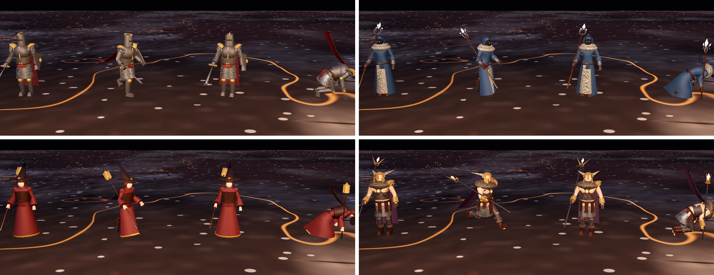
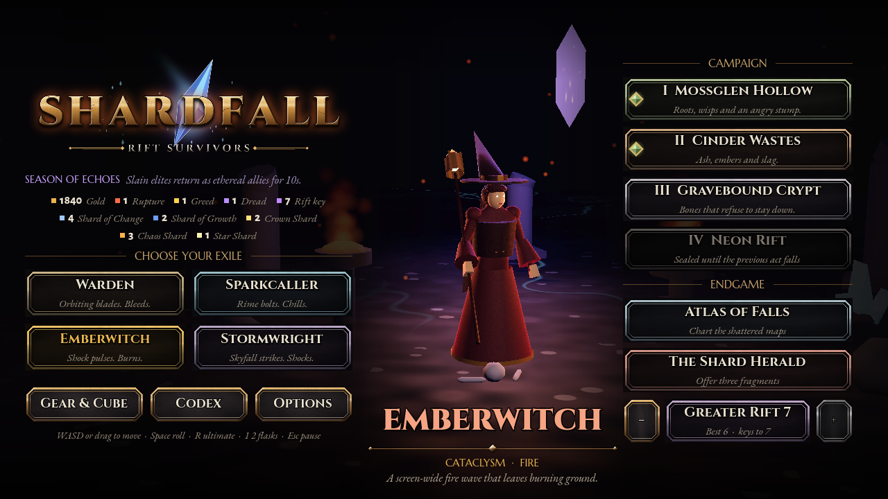
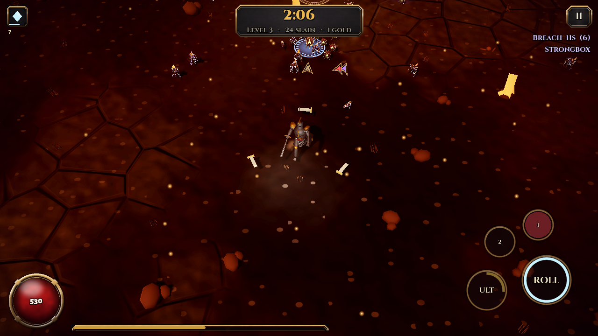

# Models: Blender pipeline, textures, and AI-generated creatures

The four heroes and three bosses are rigged, animated, textured models generated by a Python
script in **headless Blender 4.5 LTS**. They replace the procedural rigs through the existing model
slots (`godot/models/README.md`). Delete a `.gltf` to get the procedural version back.

```bash
# one-time: Blender in ~/toolchains (no GUI, no account)
curl -fL https://download.blender.org/release/Blender4.5/blender-4.5.15-linux-x64.tar.xz | tar xJ -C ~/toolchains
# textures: download CC0 sets, then pack them to 512 px colour / normal / ORM
python3 tools/blender/fetch_textures.py /tmp/texraw
python3 tools/blender/pack_textures.py /tmp/texraw godot/models/textures
# models: all, or name some (warden spark ember storm tyrant guardian herald)
~/toolchains/blender-4.5.15-linux-x64/blender -b --factory-startup --python tools/blender/build_models.py -- warden
```

## How a model is built (`tools/blender/build_models.py`)

1. **Skeleton**: `humanoid()` lays out joints for a given height, bulk, hunch and limb length,
   and the bones that connect them (21 bones: root, hips, spine, chest, neck, head, two arms and legs
   with hands and feet, and a three-bone cape chain). Bosses add wing bones. The Herald has its own
   rig: a core and three ring bones, each carrying four shard bones.
2. **Body**: the same joint graph drives a Skin modifier with per-joint radii, then subdivision.
   That gives an organic body with no manual sculpting. It is bound to the skeleton with Blender's
   automatic (heat) weights.
3. **Gear**: helmets, pauldrons, plates, hoods, hats, horns, belts, robes, capes and weapons are
   procedural primitives (bmesh). Rigid pieces are bound 100% to one bone. Capes follow the cape
   chain, and robes and tassets blend from the hips toward each thigh, so a stride swings the hem
   without tearing it.
4. **UVs**: a world-scale box projection gives every part the same texel density with no seams to
   author.
5. **Materials**: PBR sets from `godot/models/textures/` with a tint (exported as glTF
   `baseColorFactor`), normal maps and ORM maps. Emissive materials are named `glow*`.
6. **Animation**: poses are written as rotations in character axes (X forward, Y left, Z up) and
   converted to each bone's local space, so the clips read like choreography:
   * heroes: `idle` (breathing, cape drift), `run` (stride, arm swing, bob, trailing cape), `cast`
     (turn and thrust), `roll` (tucked forward flip), `hit` (recoil), `die` (buckle and fall back)
   * bosses: `idle`, `walk` (heavy stomp), `attack` (wind-up, slam, recover), `hit`, `die`. The
     Herald's attack flings its shards outward and its death scatters them.
7. **Export**: glTF with an external `.bin`, sharing one texture folder, so the game ships each
   texture once.

| Model | Height | Triangles | Look |
|---|---|---|---|
| Warden | 50 | ~9k | great helm with crest, layered pauldrons, cuirass, mail skirt and tabard, cape, rune longsword, heater shield |
| Sparkcaller | 50 | ~9k | deep hood with a shadowed face and frost eyes, fur mantle, split coat over a robe, silver bracers, ice-crystal staff |
| Emberwitch | 48 | ~9k | wide-brim crooked hat, ember eyes, corset, flared robe with a gold hem, bell sleeves, half cape, lantern staff |
| Stormwright | 52 | ~9k | brass horned helm, fur mantle, crossed harness with a storm rune, one great pauldron, chain and leather kilt, cape, forked crystal staff |
| Tyrant (act bosses) | 125 | ~8k | horned skull, glowing ribcage furnace, spined back, spiked pauldrons, bat wings, cleaver; glow recoloured per act |
| Guardian (rift) | 115 | ~5k | stone golem with crystal growths and a core gem |
| Herald (pinnacle) | floats at 70 | ~4k | crystal-blade cage around a glowing heart, three counter-rotating gold rings with twelve shards |

## In the game

`HeroRig` and `BossRig` load the models through the slots and:
* loop `idle`, `run` and `walk`, and match the run speed to movement speed
* drive `roll` from the simulation's dodge timer (the clip is scrubbed, so the flip always lands
  when the roll ends)
* add a per-instance rim light and a red hit-flash overlay
* flare `glow*` materials on casts, and pulse and recolour them for bosses (one tyrant model gives
  the green, ember, pale and neon bosses)
* let a boss attack play out in full (wind-up, slam, recover), so hits don't cut it short

Textures are imported as lossy WebP with mipmaps, not GPU-compressed formats, which keeps the web
build small.

## AI-generated creatures (Tripo or Meshy)

Both services turn a prompt or a concept image into a textured mesh. Both can also auto-rig and
animate a humanoid through their APIs. The plan for Shardfall's swarm and elites: generate, then
clean up in this same Blender pipeline (decimate to a budget, rescale, re-orient to +X, retexture
or tint, add the UV2 limb ids the foe shader animates). The results drop into `godot/models/foes/`.

**Keys can't be acquired automatically.** Each service needs an account, accepted terms of service,
and (for Meshy's API, and for Tripo beyond any free grant) a payment method. Only the account owner
can do those. Once you have a key:
1. In a cloud Claude Code session, the session asks for it through a secure credential form (the
   key is never pasted into chat). The environment's proxy then adds it to requests for that host
   only, and the code never sees the value.
2. Locally, set `TRIPO_API_KEY` or `MESHY_API_KEY` in your shell.

At the time of writing (check the live pages):
* **Tripo**: pay-as-you-go API credits at developers.tripo3d.ai/en/pricing (text-to-3D is about
  $0.10 a model). Its developer program grants extra credits to game developers. The free Studio
  plan is for the web app, and its outputs need attribution.
* **Meshy**: API keys need the Pro plan or above (about $20 a month for 1,000 credits). A
  text-to-3D preview costs about 20 credits, auto-rigging about 5, and each animation about 3.

Check each service's licence terms for commercial use before shipping generated assets.

## Critique passes

| Pass | Found | Fixed |
|---|---|---|
| 0 | Steel rendered almost black: fully metallic with nothing bright to reflect in the dark scenes | Steel and chain lifted; metalness capped at 0.6 |
| 1 | Steel overshot to beige; the Sparkcaller read grey; the Emberwitch's eyes sat inside her head; the Stormwright's horns were oversized blades | Cool steel tint and stronger normals, a saturated frost coat, eyes moved forward with a fringe, shorter swept-up horns, darker skin and belly wraps |
| 2 | Guardian crystals too small to read; the Herald was all thick gold rings around an opaque crystal | Bigger shoulder, forearm and back crystals; thin rings; a cage of crystal blades around a visible glowing heart |
| 3 | Textured heroes too dark on the title stage and in play; the Herald's crystal read grey in its arena | Per-instance rim light on authored models, a warm key light and cool back light on the title stage, faint violet self-glow on the Herald's crystal |




More: [bosses pass 1](screenshots/models_bosses_pass1.png), [guardian and herald pass 2](screenshots/models_guardian_herald_pass2.png),
[herald in game](screenshots/models_ingame_herald.png), [pass 0 dark steel](screenshots/models_pass0_dark_steel.png).

The web build is now 19.7 MB as a single file. For the artifact host it splits into a 14 MB page
plus a 5.7 MB `shardfall_artifact_data.js` (`tools/pack_web.py --split`).
